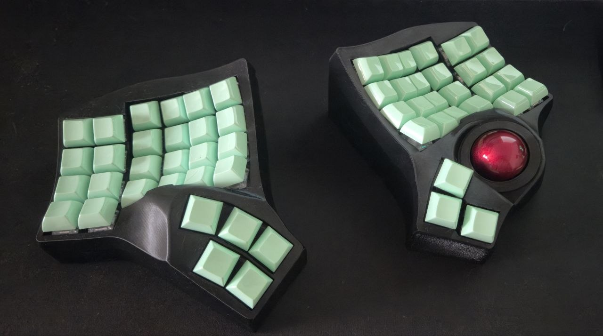

<h1 align="center">charybdis.uf2</h1>

  Bilingual <b>EN/RU</b> ZMK firmware for a wireless Charybdis with a PMW3610 trackball. 
  One layout for Russian and English — code included — tuned for <b>vim</b> and <b>Hyprland</b>.

  

  <b><a href="https://barghest0.github.io/charybdis.uf2/">→ Interactive layout reference</a></b> — every layer drawn, hover any key for details.

## Highlights

- **Home-row mods (GACS)** — hold `A/S/D/F` (mirrored on the right) for Gui/Alt/Ctrl/Shift, tap for the letter. Ctrl and the vim leader `\` stay plain thumb keys — zero hold-tap latency where it hurts.
- **Layers on thumbs** — Sym on Space, Num on the language key, Nav with a caps tap-dance, Hypr (ready-made `Super+…` binds for Hyprland) on Enter.
- **Trackball, three modes** — auto mouse layer on ball movement with clicks under both hands, scroll and snipe via hold or toggle.
- **One-hand remote** — a thumb chord turns the right half into a couch remote for video: seek, volume, fullscreen, clicks.

## Layers

| # | Layer | Access |
|---|-------|--------|
| 0 | Base | always on |
| 1 | Nav | hold thumb 49 |
| 2 | Num | hold the Lang key |
| 3 | Sym | hold Space |
| 4 | Fn | hold thumb 51 |
| 5–7 | Mouse / Scroll / Snipe | ball movement / toggles / D‑F holds |
| 8 | Hypr | hold Enter |
| 9 | OneHand | Bspc+Enter chord |

## Hardware & flashing

Two `nice!nano v2` halves; the right half is the BLE central and carries the trackball (PMW3610). Push to `master` — GitHub Actions builds the firmware; download the artifact, drop each half into its bootloader (bottom outer corners on the Fn layer) and copy the matching `.uf2`.
